<p align="center">
  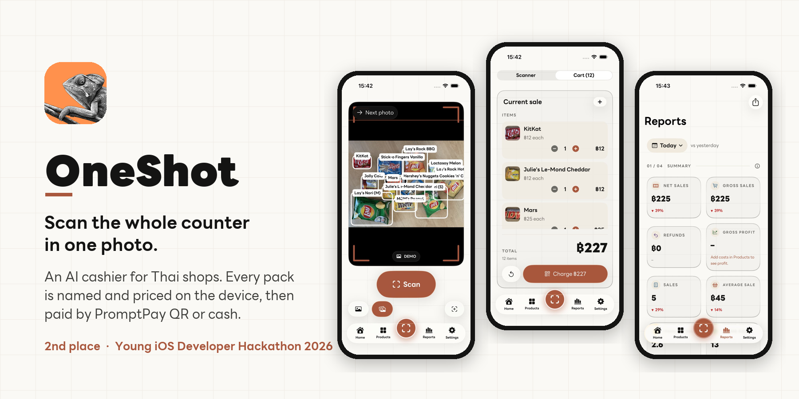
</p>

<p align="center">
  
  
  
  
  
  
  
</p>

<p align="center">
  <b>OneShot</b> is an AI cashier for Thai corner shops. Hold an iPhone or iPad over the counter, tap <b>Scan</b>,
  and every pack in view is named and priced from one photo, on the device, with no internet. The customer pays by
  PromptPay QR or cash, and the shop gets receipts, stock, a day close and reports.
</p>

<p align="center">
  <a href="https://oneshot-pos.pages.dev">Website &amp; privacy</a> ·
  <a href="#screenshots">Screenshots</a> ·
  <a href="#how-it-works">How it works</a> ·
  <a href="#build-and-run">Build</a>
</p>

---

## Why

A barcode lane scans one item at a time, so a shopper with a basket of snacks waits while every pack goes past the
scanner. OneShot rings up the whole pile in one tap and never guesses a price: anything it isn't sure of turns yellow
for the cashier to pick.

## Screenshots

<table>
  <tr>
    <td align="center">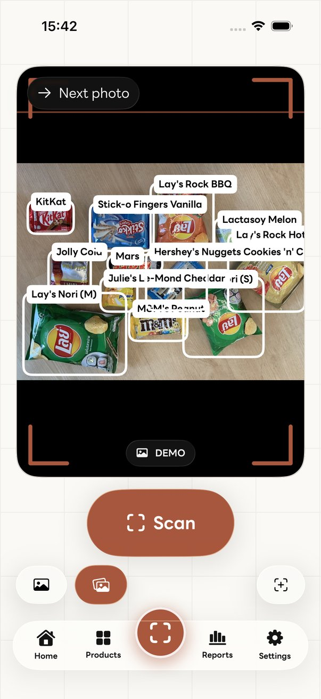<br><sub>Scan the counter</sub></td>
    <td align="center">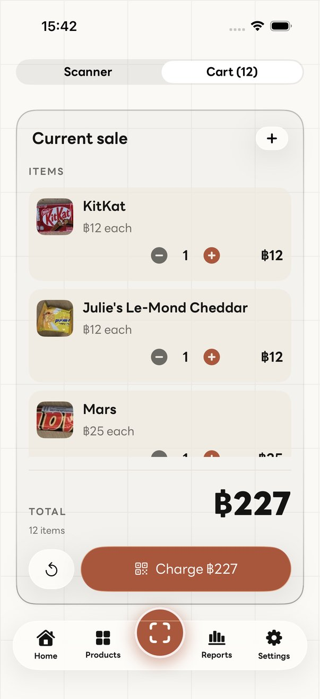<br><sub>Cart, one swipe away</sub></td>
    <td align="center">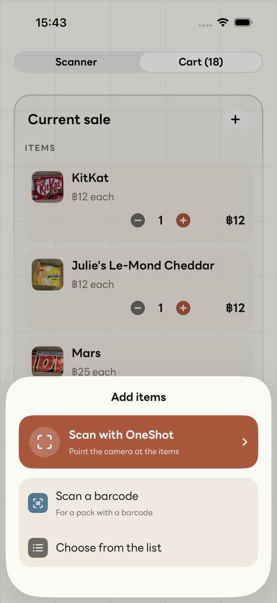<br><sub>Add by camera, barcode or list</sub></td>
    <td align="center">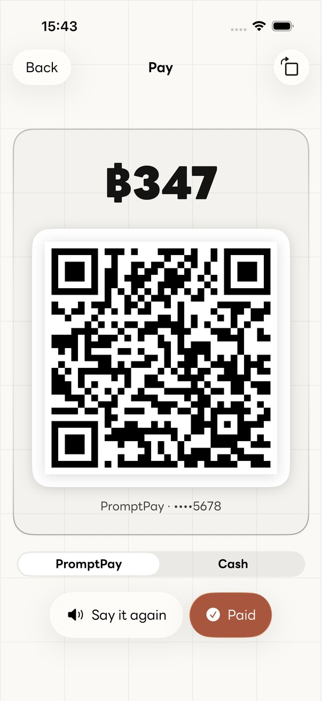<br><sub>PromptPay QR or cash</sub></td>
  </tr>
  <tr>
    <td align="center">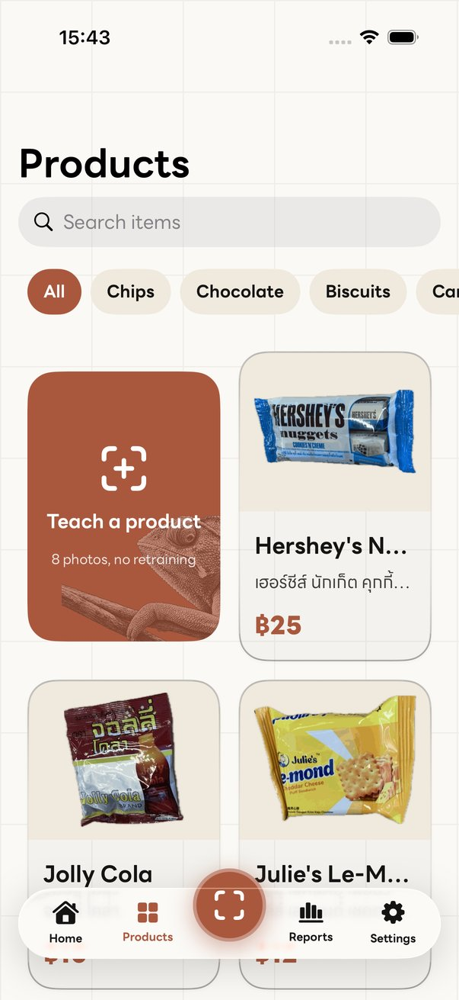<br><sub>Products and filters</sub></td>
    <td align="center">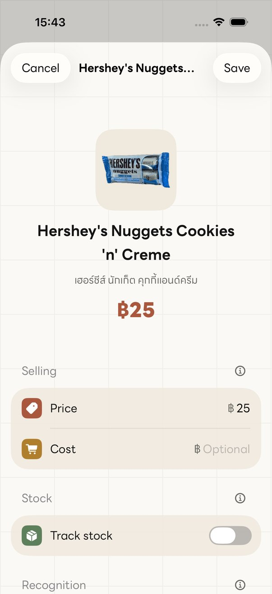<br><sub>Price, cost and stock</sub></td>
    <td align="center">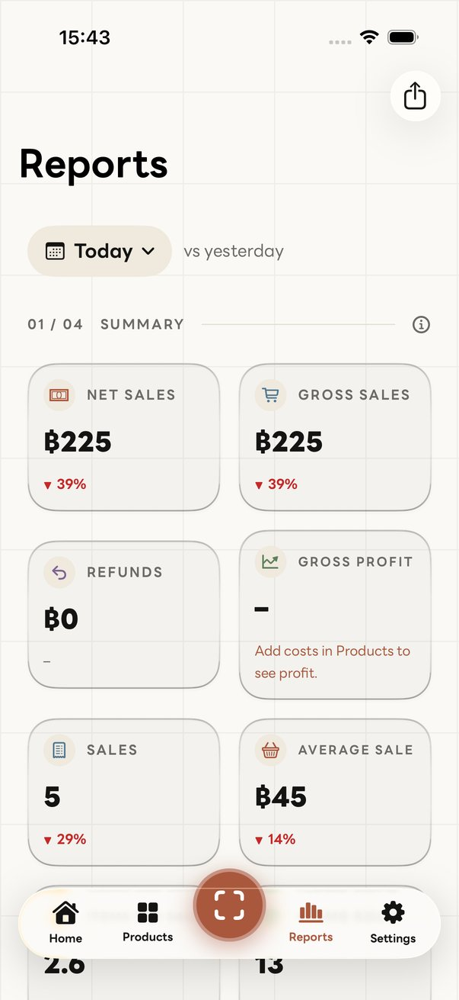<br><sub>Reports that expand</sub></td>
    <td align="center">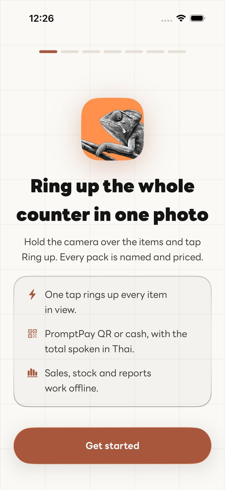<br><sub>Set up in a minute</sub></td>
  </tr>
</table>

<p align="center">
  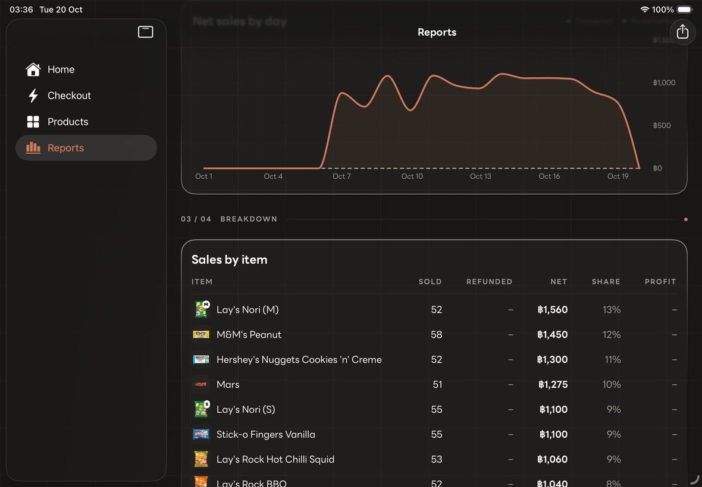
  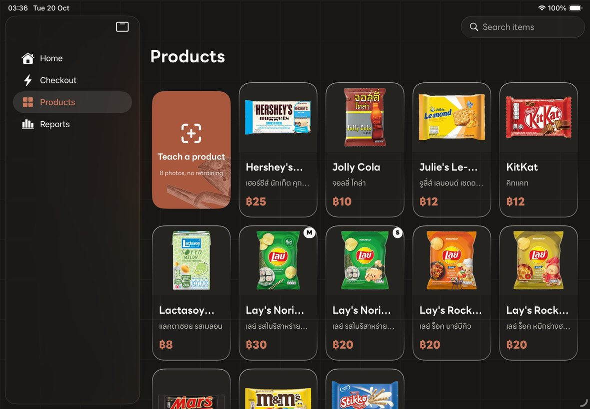
</p>

## Features

**Checkout**
- **One-tap scan.** A Core ML detector boxes every pack; a few-shot gallery of Vision FeaturePrints votes on each
  box too. When they agree the item goes on the bill (green), otherwise it turns yellow with the top guesses.
- **Swipe between scanner and cart** on iPhone, to check the bill against the frozen photo.
- **Add items** by scanning more, by barcode (VisionKit), or from the list.
- **Pay** with a dynamic PromptPay QR (EMVCo, amount locked) or cash with change. The total is spoken in Thai, and the
  receipt can be shared or printed.

**Shop**
- **Teach a product** in about 10 seconds: 8 photos and a price, no retraining.
- **Stock** with reorder points, **refunds** behind an optional PIN, and a **day close** with over/short.
- **Reports** for today, yesterday, this week and this month against the period before: net, profit, items,
  categories, payments, items bought together and scan speed. Every chart opens full screen; there's also a monthly
  statement PDF for the bank.
- **On-device AI summary** with Apple Intelligence (Foundation Models) where the device supports it.

**Accounts and data**
- **Works fully offline.** An optional account (Sign in with Apple or Google) backs the shop up and keeps the owner's
  iPhone and iPad in step. The device stays the source of truth (`Cloud/SyncEngine.swift`).
- **Help improve OneShot** (opt-in, off by default): counter photos of paid sales, with faces blurred on the device,
  for training OneShot's own models. Turning it off deletes everything sent.
- **Backup and restore** to a folder the owner picks, e.g. iCloud Drive.
- **Delete account** in the app removes the account and all its server data.
- **English and Thai**, set in LINE Seed Sans TH.

## How it works

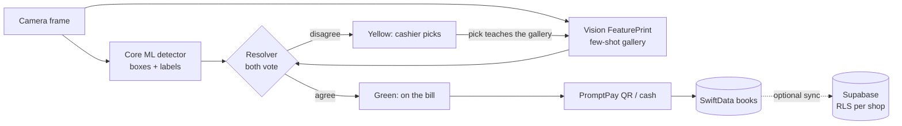

| Layer | What it uses |
|---|---|
| Recognition | Core ML object detector, Vision FeaturePrint gallery, instance splitter, a voting resolver |
| App | SwiftUI (Liquid Glass), SwiftData, TipKit, VisionKit barcodes, AVSpeechSynthesizer (Thai), Foundation Models |
| Backend (optional) | Supabase Postgres with Row Level Security on every table, Storage, Edge Functions (account deletion, retention, support form) |
| Website | Static privacy and support page on Cloudflare Pages (`site/`) |

## Build and run

```bash
brew install xcodegen      # once
xcodegen generate          # writes OneShot.xcodeproj from project.yml
open OneShot.xcodeproj     # scheme OneShot, an iPhone, an iPad or a simulator
```

- **Device builds** need a development team: set `DEVELOPMENT_TEAM` in `project.yml`.
- **Accounts** are off unless the build knows a Supabase project. Create `OneShot/Secrets.xcconfig` (gitignored) with
  `SUPABASE_HOST = <ref>.supabase.co` and `SUPABASE_ANON_KEY = <anon key>`, then run `xcodegen generate`. The schema,
  RLS policies and Edge Functions are in `supabase/`; see `docs/BACKEND.md`.
- **No camera?** On the simulator the **Demo camera** is on: bundled table photos stand in for the live feed and go
  through the same recognition. Settings › Demo & sample data can add two weeks of sample sales for Home and Reports.

## Tests

```bash
# Unit tests: bill maths, PromptPay, reports, store, backup/restore, stock, sync, training labels, localization
xcodebuild test -scheme OneShot -destination 'platform=iOS Simulator,name=iPhone 17' -testLanguage en -testRegion en_US

# UI tour: every page on iPhone and iPad, with a screenshot of each (attachments in the .xcresult)
xcodebuild test -scheme OneShotTour -destination 'platform=iOS Simulator,name=iPhone 17' -resultBundlePath build/tour.xcresult
python3 tools/tour_shots.py build/tour.xcresult docs/screens/iphone

# Row Level Security against the linked Supabase project
python3 supabase/local-check/remote.py

# Detector exam: the app's whole scan path on the Mac, against 42 real counters (needs data/, kept out of git)
swiftc -O tools/grade/main.swift OneShot/Recognition/{Resolver,Detector,Splitter}.swift OneShot/Log.swift -o build/grade
build/grade OneShot/Resources/Detector.mlpackage
```

## Project layout

| Path | What |
|---|---|
| `OneShot/Camera` | Capture session, live detection, the demo feed |
| `OneShot/Recognition` | Detector, FeaturePrint gallery, instance splitter, the voting resolver |
| `OneShot/Data` | Catalog, bill, payments, sales log, store, stock, reports |
| `OneShot/Cloud` | Supabase client, sync engine, opt-in training photos |
| `OneShot/Views` | SwiftUI screens; `Theme.swift` and `Typography.swift` hold the design system |
| `supabase/` | Migrations, RLS tests, Edge Functions |
| `site/` | Privacy policy and support page |
| `tools/` | Training data, model export and grading, packshots, brand assets, packaging |
| `docs/` | Backend notes, model comparison, App Store listing, review notes and guideline audit |

## Status

OneShot placed **2nd at the Young iOS Developer Hackathon 2026** (Swift Coding Club TH) and is being prepared for the
App Store; see [`docs/appstore/AUDIT.md`](docs/appstore/AUDIT.md) for what's left.

## Credits

- **Font:** LINE Seed Sans TH © LY Corporation, SIL Open Font License 1.1 (`Resources/Fonts/OFL-LINE-Seed.txt`).
- **Detector:** see `docs/MODEL-COMPARISON.md`. The current model is trained with Ultralytics YOLO (AGPL-3.0); an
  Apache-2.0 YOLOX replacement is in training for the App Store build.
- **Product pictures:** our own photos of the packs, cut out with Vision (`tools/packshots.swift`). The brands and their
  packaging belong to their owners.
